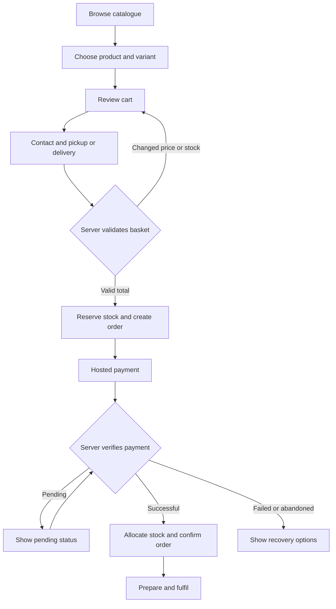
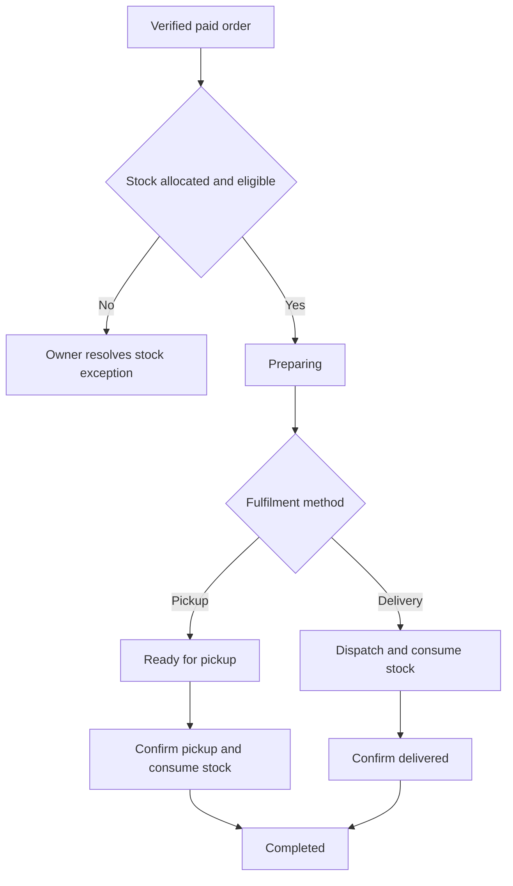

# 03 — App flow and screen behaviour

Version 2.0 | Business rules: [product requirements](01_PRODUCT_REQUIREMENTS.md) | State storage: [schema](05_BACKEND_SCHEMA.md)

## Route map

| Route | Audience | Purpose |
| --- | --- | --- |
| `/` | Public | Brand, categories and catalogue entry |
| `/shop` | Public | Search/filter/paginated catalogue |
| `/products/[slug]` | Public | Product details and variant selection |
| `/cart` | Customer | Editable cart; no stock hold yet |
| `/checkout` | Customer | Details, fulfilment option and final review |
| `/checkout/return` | Customer | Provider return; server checks status |
| `/orders/[id]` | Authorized customer/staff | Limited order confirmation/status |
| `/orders/access` | Customer | Exchange a protected order link for scoped access |
| `/contact`, `/delivery`, `/returns`, `/privacy` | Public | Owner-approved business information |
| `/staff/sign-in` | Staff | Authentication |
| `/admin` | Active staff | Operational overview |
| `/admin/products` | Owner | Catalogue/prices/images |
| `/admin/inventory` | Active staff | Receiving, stock, alerts and history |
| `/admin/sales/new` | Active staff | Completed walk-in/WhatsApp sale |
| `/admin/orders` | Active staff | Queues and order detail |
| `/admin/reports` | Owner | Defined reports and exports |
| `/admin/settings` | Owner | Staff/configuration management |

Routes appear when their phase is implemented. Never render fake working actions for later features.

## Customer purchase

Browse allows category, name and brand filtering. Product detail requires an explicit available variant; an unavailable choice cannot be added. Cart quantities are provisional. At checkout, collect name, email and phone, plus an address only for delivery. Email is needed for the proposed payment/receipt flow. Show a final cost breakdown before payment.

The server recalculates and reserves the basket. If the displayed quote is stale, show the corrected total and obtain confirmation before payment initialization. Delivery outside configured zones leads to pickup or contact/request-for-quote, not an invented charge. Refreshing or double-clicking submit reuses the same idempotent request.

The return URL is not proof of payment. A customer who closes the browser can still have a paid order through webhook processing. The status page polls with bounded intervals while pending and offers support without encouraging repeated payment.

After a reservation expires, the pending provider transaction may still succeed. Reallocate stock only if the order was not explicitly cancelled and stock is still available. Otherwise show a paid exception to staff for resolution/refund. Do not promise dispatch until the exception is resolved.

## Staff start and stock receiving

Sign in; verify identity and active membership; load allowed navigation. Missing/disabled membership produces access denied with sign-out/support options. Do not redirect indefinitely.

Receiving: choose SKU; enter batch code, quantity, expiry/precision where required; review; commit once; show new physical and available quantities. Cost entry is owner-only when enabled. Missing expiry blocks saleability for expiry-controlled items. Failed receiving preserves the form without showing a success toast.

Counter/WhatsApp sale: select SKU/quantity; calculate total; confirm actual payment channel/reference; commit sale and handoff together. An inquiry or promised transfer is not a completed sale. Display receipt and stock movement. A repeated request returns the existing result.

## Order fulfilment

Preparing requires a paid or explicitly confirmed counter-sale order and valid allocation. At handoff, recheck batch expiry/quarantine. If unavailable, block handoff and resolve replacement/allocation/refund. Customer-facing status should explain that the order needs attention without exposing internal notes.

## State transitions

| Dimension | Allowed normal progression | Special handling |
| --- | --- | --- |
| Payment | unpaid → pending → paid | Failed attempts remain recorded; order payment reflects successful funds |
| Refund | requested → processing → succeeded/failed | Only verified success changes refunded totals |
| Delivery | unfulfilled → preparing → dispatched → completed | Dispatched stock is not restored by a cancellation click |
| Pickup | unfulfilled → preparing → ready_for_pickup → completed | Consume stock at pickup confirmation |
| Cancellation | unfulfilled/preparing/ready_for_pickup → cancelled | Paid orders require owner authority and a refund obligation |
| Allocation | held → committed → consumed | held → released on expiry/cancel; committed → released on authorized pre-handoff cancellation |

Do not move paid back to failed because a later payment attempt fails. A second actual successful charge is recorded as an overpayment exception, not discarded. An explicit customer cancellation must not be reversed by a late webhook.

## Returns and refunds

Customer contacts the business using published policy. Owner reviews the order and records a reason. Before handoff, an authorized cancellation releases unconsumed allocation and records any refund obligation. After handoff, use a return process; do not rewind dispatch to create stock.

Returned units enter quarantine with a link to the sold line. Staff inspect; owner-approved acceptance may release quarantine only if the item remains eligible for sale. Damaged/expired units remain blocked or are written off. A refund may exist without a physical return and vice versa; report both accurately.

## Screen failure requirements

| Situation | UI response |
| --- | --- |
| Search empty | Explain no matches and offer clear filters |
| Product unpublished | Not-found response; no private draft details |
| Stock changed | Explain affected item and preserve the remaining cart |
| Payment pending | Show pending and existing reference; safe status refresh |
| Network failed after submission | Recover by request key/order status, not blind duplicate creation |
| Staff session expired | Reauthenticate, preserve safe draft input, recheck authority before save |
| Protected order token invalid | Generic access failure, no order-existence leak |
| Receipt delivery failed | Order remains paid; retry notification internally |

## Navigation and focus

Public users always have a clear route back to shop/cart. Staff use a task-focused sidebar on desktop and a compact menu on phones. Back navigation preserves search state where practical. Dialogs return focus to their trigger; destructive actions show the affected item and consequence. Status announcements are accessible and do not rely solely on colour.
